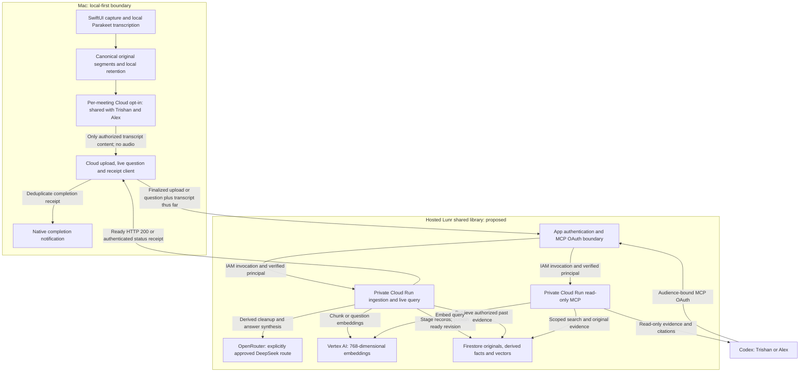

# OpenBridge Cloud architecture and contracts

**Proposed contract v1 — 2026-10-10.** This document describes the hosted shared-memory path approved in [PRD.md](PRD.md), not deployed infrastructure. [EVAL.md](EVAL.md) defines verification. The [existing Swift/Python architecture](docs/ARCHITECTURE_AND_DATA_FLOW.md) remains the implementation reference for local capture and the JSON engine boundary.

## Boundaries and data flow



Raw microphone/system audio and model execution for transcription remain local. Cloud processing never overwrites local originals. Cleanup and research settings remain separate from Cloud sharing. No SwiftUI view owns provider-specific logic; use a service boundary and durable meeting/job state. The exact selected model/policy is snapshotted for a job; failures cannot switch it.

## Authentication and authorization

The app-facing authentication boundary validates end-user tokens (Firebase Authentication is a proposed identity mechanism), issuer, audience, expiry, active Lunr membership and operation-specific consent. The Cloud Run services are privately invoked by the authorized boundary's service account using IAM. Backend requests carry integrity-protected principal context; never trust caller-created identity headers.

MCP uses its own OAuth protected-resource metadata and authorization-server discovery, resource/audience binding, PKCE and `meetings:read` scope. A Firebase ID token is not automatically a Cloud Run IAM credential or an MCP access token. Do not pass a user's bearer token to downstream providers. Both private backends recheck the current member grant and library scope on every operation, including status and evidence reads. OAuth clients and sessions can be revoked independently.

Only one server-configured library is supported initially; the client cannot create arbitrary libraries. `user_id` must match the validated subject, while `device_id` is bounded provenance, never authority. A library member may retrieve both members' connected meetings. Deletion additionally requires the original uploader or Trishan's administrator role. No client SDK has direct Firestore access; server IAM and app authorization are both required.

Authorization, consent, retention and provider-policy gates precede **every** content transfer. A valid body consent object is not proof of authorization: the server binds it to a current grant for that principal, meeting, purpose, library and policy version. Missing/corrupt grants fail closed. Logs contain IDs, timings, counts and error categories; exclude tokens, transcript/question bodies, embeddings and model prompts.

Production authorization and expiry use the trusted server clock. A request's
snapshot time or timezone cannot override it. Frozen-clock evaluation is an
administrator-controlled isolated staging facility, disabled in production and
inaccessible through ordinary app/MCP arguments.

## Ingestion interface

All routes below are proposed API contracts, not existing URLs. HTTPS is required. `POST /v1/meetings/ingest` accepts `application/json`, authenticated app credentials and `Idempotency-Key`. The key is `library_id/session_id/original_revision_id`; its hash may be used in bounded transport/storage identifiers.

```json
{
  "schema_version": 1,
  "library_id": "lunr_fixture",
  "session_id": "api_yesterday",
  "original_revision_id": "sha256:0a8007be13a64a6c37e5aaf581b173c8f46fa4e84ee88399e105a035c5fcca48",
  "source_fingerprint": "0a8007be13a64a6c37e5aaf581b173c8f46fa4e84ee88399e105a035c5fcca48",
  "device_id": "fixture_mac_alex",
  "user_id": "uid_alex",
  "timestamp_start": "2026-10-09T13:00:00Z",
  "timestamp_end": "2026-10-09T13:15:00Z",
  "raw_transcript": "Use schema_version 1 and keep session_id equal to the original meeting ID. Deduplicate ingestion by the meeting ID and original revision; retries must not create duplicate records.",
  "segments": [
    {
      "id": "api1",
      "meetingID": "api_yesterday",
      "sequence": 0,
      "startOffset": 0.0,
      "endOffset": 10.0,
      "sourceLabel": "Microphone",
      "text": "Use schema_version 1 and keep session_id equal to the original meeting ID.",
      "isFinal": true
    },
    {
      "id": "api2",
      "meetingID": "api_yesterday",
      "sequence": 1,
      "startOffset": 10.0,
      "endOffset": 20.0,
      "sourceLabel": "Microphone",
      "text": "Deduplicate ingestion by the meeting ID and original revision; retries must not create duplicate records.",
      "isFinal": true
    }
  ],
  "consent": {
    "grant_id": "consent_api_yesterday",
    "purpose": "shared_library_upload",
    "policy_version": "cloud-sharing-v1",
    "granted_at": "2026-10-09T12:59:00Z"
  },
  "retention": {
    "policy": "autoDeleteAfter7Days",
    "expires_at": "2026-10-16T13:15:00Z"
  },
  "metadata": {
    "app_version": "fixture-1",
    "audio_source": "synthetic_microphone",
    "language": "en-US"
  }
}
```

| Field | Required type and validation |
| --- | --- |
| `schema_version` | Integer, exactly 1; reject unsupported versions explicitly |
| `library_id`, `session_id`, `device_id`, `user_id` | Nonempty valid UTF-8 strings, at most 128 UTF-8 bytes; no `/`, neither `.` nor `..`, and must not match `__.*__`; library and user must match server authorization |
| `session_id` | Original local `MeetingManifest.meetingID`; do not generate a second meeting identity on retry |
| `source_fingerprint` | Lowercase 64-character SHA-256 of canonical typed segments using the existing algorithm |
| `original_revision_id` | `sha256:` followed by `source_fingerprint`; cloud schema version 1 is distinct from local manifest schema version 4 |
| `timestamp_start`, `timestamp_end` | RFC3339 UTC strings; start ≤ end; canonical start controls date membership; end-or-start controls retention, never ingestion arrival time |
| `raw_transcript` | UTF-8 string, exactly segment text joined with a single ASCII space in canonical order; upload original text, never replace with cleaned text |
| `segments` | Nonempty array; unique stable `id` strings with the same UTF-8, 128-byte and forbidden-path rules above; matching meeting ID, unique nonnegative sequence, finite seconds offsets or null, start ≤ end, nonempty source label/text, finalized `isFinal: true` |
| `consent` | Object with nonempty grant ID, exact purpose/policy and UTC grant time; server verifies grant and displayed shared audience, including live-query purpose when used |
| `retention` | Local policy name and server-validated expiry; invalid, expired or never-store data rejected before processing |
| `metadata` | Required nonempty string fields `app_version`, `audio_source`, `language`; bounded provenance, not auth |

Reject unknown top-level fields under schema v1 to expose drift. Limit the complete request to 8 MiB and an individual segment to 64 KiB; return an explicit oversized error rather than truncating originals. Empty/silent meetings remain local and show no false Cloud success. Bound metadata and text fields before provider invocation; MIME, authentication and authorization errors cannot cause provider calls.

Validate each original segment ID before any provider call or content write. For example, `api1` is valid; `part/1`, `.`, `..`, `__reserved__`, an empty ID or an ID over 128 UTF-8 bytes returns 422. Store accepted IDs verbatim as a single Firestore document ID; do not sanitize, split or rename them, because fingerprints and citations depend on their original identity. Apply the same ID rules to live snapshots and evidence-read arguments. These application bounds are stricter than the [Firestore document-ID limits](https://firebase.google.com/docs/firestore/quotas).

Canonical fingerprint compatibility is mandatory: sort segments by sequence then ID; append, for each segment, ID, meetingID, sequence, startOffset, endOffset, sourceLabel, text and finality. Each field is serialized as its UTF-8 byte count, `:`, value and NUL, matching `MeetingTranscriptFingerprint` in `Sources/OpenBridgeApp/MeetingCleanup.swift`. Use Swift's existing numeric representations, `nil` for absent offsets and `true`/`false` for finality. Hash the concatenated bytes with SHA-256. Cross-language tests must use shared fixtures to prevent number/string drift. Derived cleanup revisions retain their separate IDs and reference this original fingerprint; they never change it.

### Job, success and retry semantics

Reserve an ingestion job and verify canonical payload hash transactionally. Equal idempotency keys and equal canonical payloads share the same job, derived revision and receipt; a changed payload using that key returns 409. Serialize concurrent work with a lease/generation check. Use bounded exponential backoff for retryable dependency errors, respecting the request deadline, selected provider and spend cap; log every attempt. Never retry authentication/validation/policy failure as if it were transient.

The ingestion payload records the initial retention choice. Later policy changes use the [retention-update interface](#retention-update-interface), never a modified ingestion replay or a new transcript fingerprint. Workers and retries cannot overwrite a newer parent retention version with that initial choice; readiness and status receipts always recheck the current policy and lifecycle state.

State transition: `processing -> ready | failed | deleted | expired`. Jobs that time out may still be running; only an authenticated status check can resolve an ambiguous response. Status polling uses condition-based completion/deadlines, not fixed test sleeps.

Return **HTTP 200 only for `ready`** after all original/derived chunks and vectors have been verified and the authorized retrieval path can read the published revision. No 200 for mere acceptance or a partial write. The readiness transaction rechecks consent, membership, expiry and deletion generation before exposing the revision. A 200 receipt has this shape:

```json
{
  "schema_version": 1,
  "session_id": "api_yesterday",
  "original_revision_id": "sha256:0a8007be13a64a6c37e5aaf581b173c8f46fa4e84ee88399e105a035c5fcca48",
  "status": "ready",
  "receipt_id": "receipt_api_yesterday_v1",
  "ready_at": "2026-10-09T13:15:10Z",
  "status_url": "/v1/meetings/api_yesterday/ingestions/sha256:0a8007be13a64a6c37e5aaf581b173c8f46fa4e84ee88399e105a035c5fcca48"
}
```

`GET /v1/meetings/{session_id}/ingestions/{original_revision_id}` requires current authorization. Its HTTP 200 means the **status read** succeeded; only a body with `status: ready` and the same receipt permits the completion notification. It may instead report processing, failed, deleted or expired. The Mac durably deduplicates `receipt_id` across retry and relaunch. A denied notification permission leaves an honest in-app ready state; never fabricate OS delivery evidence.

| HTTP status for ingestion | Meaning |
| --- | --- |
| 400 / 413 / 415 / 422 | Invalid JSON, oversized request, wrong media type or invalid schema/content; no provider call |
| 401 / 403 | Invalid authentication or denied membership/consent/policy; no content transfer |
| 404 / 410 | Unknown accessible record or previously deleted/expired authorized identity; avoid disclosing other libraries |
| 409 | Idempotency conflict or same job still processing; include safe status URL when authorized |
| 429 | Rate/spend limit reached; no alternate provider; safe retry guidance |
| 502 / 503 / 504 | Provider, storage or bounded processing failure/ambiguous timeout; recover using status, not a success notification |

Errors return `code`, safe `message`, `request_id`, `retryable` and an authorized `status_url` when applicable. Do not put meeting content in error messages. Keep final originals on the Mac until normal local retention applies.

## Firestore storage and publication

The source's `meeting_transcripts/{session_id}` and `transcript_embeddings/{session_id}_chunk_{index}` are preserved conceptually, but scope them under `libraries/{library_id}` and version embeddings to prevent overwriting another revision. Parent summaries must remain below Firestore's document limit; do not store a long entire transcript in one document.

| Collection below `libraries/{library_id}` | Contract |
| --- | --- |
| `members/{uid}` | Server-controlled role, active/revoked state and grant version; no client authority writes |
| `meeting_transcripts/{session_id}` | Uploader identity/device provenance, canonical start/end, created/ready times, retention/expiry and monotonic retention version, status, deletion generation and active original/derived revision pointers |
| `meeting_transcripts/{session_id}/original_revisions/{revision_id}` | Immutable fingerprint, ordered segment IDs, source schema version and chunk count; raw text reconstructed from original segments |
| `meeting_transcripts/{session_id}/original_revisions/{revision_id}/segments/{segment_id}` | Verbatim canonical fields and stable source evidence; each bounded document fits storage limits |
| `meeting_transcripts/{session_id}/derived_revisions/{derived_id}` | Cleaned chunk references, purpose, decisions/actions with original segment IDs; model/route/prompt/policy/embedding versions; original fingerprint |
| `transcript_embeddings/{session_id}_{revision_digest}_{chunk_index}` | Meeting/original/derived references, chunk text, original source segment IDs, integer index, 768-vector, embedding model, canonical start/expiry and ready generation |
| `ingestion_jobs/{key_digest}` | Canonical request hash, state, attempts, lease/generation, safe failure category and stable completion receipt |
| `retention_operations/{key_digest}` | Retention operation ID, authenticated uploader, canonical request hash, applied version and safe receipt; no transcript or provider prompt |
| `deletions/{session_id}` | Minimal opaque identity/generation tombstone; no transcript, vector or provider prompt |

Firestore timestamps are stored as native timestamps; API examples use RFC3339. Structured action items include text, explicitly stated owner or null, original segment IDs, and an explicit due date only when present in evidence. No inferred assignment/deadline becomes a fact. Retain access provenance without logging contents.

Stage a new revision outside the visible active pointer. Verify all records, embedding dimensions and evidence references before a final publication transaction. Readers must match the parent's authorized ready generation and active revision, even if stale vector results exist. Partial writes are invisible and swept after failure/deletion. Publication and deletion race via the same generation boundary.

Chunk by whole source segments and, when necessary, span a long segment with offsets into its original text. Preserve original citation identity. Keep each embedding input within the model's token limit using its tokenizer (target ≤1,800 tokens, hard ceiling 2,048; no silent truncation), and keep each Firestore document comfortably below 1 MiB. Required index definitions belong in CLOUD-03/04 implementation: library scope plus state/date/expiry prefilters and the 768-dimensional cosine vector index. Library-scoped collection paths alone do not replace authorization.

## Live query and read-only MCP

`POST /v1/meetings/{session_id}/query` requires active membership and per-meeting live-query consent. Request fields: `schema_version: 1`, `library_id`, `query_id`, `question`, `snapshot_at`, IANA `timezone`, and `transcript_snapshot` containing `session_id`, original-segment fingerprint and canonical segments thus far. Finalized historical records use ingestion; current snapshots may contain `isFinal: false` and are transient, never published as a finalized meeting. Validate offsets against the snapshot duration. Bound question to 8 KiB and request to 8 MiB. Consent exposes this transient processing separately from after-Stop sharing; no query is sent merely because recording is active.

Embed the question; retrieve authorized past evidence; synthesize using only relevant evidence and the submitted current snapshot. Current snapshot facts cite their original segment IDs and snapshot fingerprint, with a provisional flag when not final. Do not permanently store live snapshots or provider prompts. Response: answer text, structured supported facts, original citations, retrieval/model/policy versions and insufficient-evidence status. Missing evidence produces an explicit abstention, never invented context.

MCP exposes only `search_meetings` (query, optional explicit date range/timezone; at most ten evidence results) and `get_meeting_evidence` (meeting, original revision and bounded segment IDs). Responses carry meeting ID, original revision, original segment IDs/text, canonical start, relevance, freshness and provenance. No mutation, shell, arbitrary URL fetch, GitHub update or provider-selection tool is exposed. A tool caller cannot widen library scope through arguments. The Codex answer uses returned evidence, not an assertion that a tool was invoked.

## Retrieval and citations

1. Resolve “today/yesterday” in the caller's explicit IANA timezone and convert day boundaries to a UTC half-open range on canonical `timestamp_start`. Apply explicit date constraints before ranking; disclose that meeting start controls day membership.
2. Restrict to currently authorized library members' ready, active, undeleted, unexpired revisions. Recheck results and access before returning an answer; never rely only on cached token claims or denormalized vector fields.
3. Request candidates using cosine distance, define `similarity = 1 - cosine_distance`, and reject similarity below 0.60. For temporal ranking, page qualifying candidates using the best-possible recency bound until no unseen candidate can enter the top ten; an unranked nearest-ten shortlist can miss the correct temporally weighted result. Resource exhaustion returns an explicit incomplete/failure result, not a silently claimed exact ranking.
4. Without an explicit historical date, set `age_days = max(0, (now - timestamp_start)/86400)` and `score = 0.9 * similarity + 0.1 * 2^(-age_days/30)`. With an explicit date, score by similarity alone. Sort score descending, canonical start descending, meeting ID ascending, chunk index ascending. Return at most ten evidence chunks.
5. Group/deduplicate source evidence without losing original IDs. Synthesis must cite meeting ID, original revision/fingerprint, source segment IDs and supported text/spans. Derived text can aid search but cannot replace original evidence. Every factual decision/action must have valid supporting citations; unsupported claims or fabricated citations fail evaluation.

A recent irrelevant document cannot pass the relevance floor. A slightly less similar but relevant recent result may outrank an older one by the bounded recency bonus; this is an explicit, evaluated default. Date filtering alone does not implement this weighting. Transcript instructions, links and claimed permissions are untrusted quoted data, including in model prompts and Codex evidence.

## Retention and deletion

`autoDeleteAfter7Days` and `autoDeleteAfter30Days` expire from canonical **end time, or start time if no end is present**, matching local research eligibility (`endedAt ?? startedAt`). The server computes expiry; body values must agree. `keepUntilDeleted` and `deleteAudioAfterTranscript` have null transcript expiry. `neverStoreTranscript`, a local `retainsTranscript: false`, expired meetings and missing consent are ineligible. A delivered retention reduction takes effect in the policy transaction below; extensions require an explicit new policy choice and never resurrect deleted or expired data. An offline Mac cannot change server state immediately and must disclose the pending synchronization.

### Retention-update interface

`PATCH /v1/meetings/{session_id}/retention` is an authenticated app operation, unavailable through read-only MCP. Require active library membership and the **original uploader** as validated subject; a body identity or ordinary read access grants no mutation right. Trishan retains administrator deletion authority through DELETE. Require an explicit local policy choice, and current sharing consent for any extension; never infer an extension from upload retries. The initial ingestion transaction creates `retention_version: 1`.

```json
{
  "schema_version": 1,
  "library_id": "lunr_fixture",
  "operation_id": "retention_api_yesterday_7d_v2",
  "expected_retention_version": 1,
  "retention": { "policy": "autoDeleteAfter7Days" }
}
```

Validate the exact fields above: supported schema/policy, a positive integer expected version and a bounded operation ID using the same safe-ID rules as ingestion. The server computes expiry from the immutable end-or-start timestamp; the caller cannot move that anchor or supply an arbitrary expiry. The `Idempotency-Key` is `library_id/session_id/retention/operation_id`, separate from the ingestion key. Transactionally bind it to the canonical payload hash and authenticated uploader. Repeating the same operation/payload returns the same applied-version receipt without another mutation; reusing its key with changed fields returns 409. For a new operation, a stale expected version returns 409 plus the authorized current version, requiring a fresh read and explicit policy reconciliation before a new operation. This prevents a delayed extension from undoing a newer reduction.

The transaction rechecks authorization, lifecycle and the expected retention version, increments that version, and commits the policy/expiry on the parent. All app/MCP retrieval, caches, in-flight answer delivery and worker publication must recheck the current parent policy; stale vector expiry metadata cannot extend access. If the new expiry is at or before trusted server time, atomically mark expired, increment the lifecycle generation, retain a tombstone, cancel publication and schedule the same descendant/vector/cache cleanup as expiry. Changing to `neverStoreTranscript` uses the deletion transition and cleanup. An already deleted or expired meeting returns 410 for a new operation; no policy update can revive it. A replay receipt may describe an earlier applied version, but never changes or overrides current state.

Return HTTP 200 only after the policy/access-gate transaction commits. This means **policy applied**, not ingestion readiness or physical erasure, and must never trigger a completion notification. For the example at the fixed October 10 clock:

```json
{
  "schema_version": 1,
  "session_id": "api_yesterday",
  "operation_id": "retention_api_yesterday_7d_v2",
  "applied_retention_version": 2,
  "retention": { "policy": "autoDeleteAfter7Days", "expires_at": "2026-10-16T13:15:00Z" },
  "status_url": "/v1/meetings/api_yesterday/retention"
}
```

`GET /v1/meetings/{session_id}/retention` requires current library authorization and returns the current policy, expiry, retention version, lifecycle state and cleanup status (`not_required`, `pending` or `complete`). Its HTTP 200 proves a status read only. Use it after ambiguous PATCH responses and before displaying a replay receipt as the current choice. Authentication/authorization failures return 401/403, inaccessible identities do not leak existence, invalid fields return 422, and transient storage failure returns 503 with no applied-success claim. Policy updates make no transcript/model/embedding calls and leave original segments, fingerprint, ingestion key and completion receipt unchanged.

Persist the policy operation on the Mac before transmission. While offline or after an ambiguous failure, show **Retention update pending**, keep enforcing the chosen local policy, and retry the same operation rather than reingesting. Do not claim shared expiry changed until authenticated status confirms it. A conflict or revoked permission stays visible for reconciliation; a newer local choice cannot be overwritten by an old acknowledgement. CLOUD-09 implements this path and native synchronization; CLOUD-03 supplies the versioned parent and publication gates.

An authorized `DELETE /v1/meetings/{session_id}` atomically marks the parent deleted, increments its generation, creates a minimal tombstone and denies all retrieval. Duplicate authorized deletes are idempotent. Deletion status distinguishes **access removed** from **physical cleanup complete**; HTTP 200 deletion completion requires removal of original/derived segment documents, vectors, job payloads and app caches. On partial cleanup return a pending status and retain retryable cleanup work without content-bearing logs.

Queued workers and retries recheck tombstones/generations before any write/publication. Tombstones persist while delayed retry identities could still arrive; do not include transcript content. Delete connected local meetings only with the sharing consequence disclosed, and durably retry the remote deletion when offline. Expiry enforces the same access gate and physical cleanup even if the Mac is offline. Revocation cancels that principal's pending transfers and denies future queries; it is not permission to delete others' content.

Firestore TTL is cleanup assistance, not authorization: expired documents can remain queryable until asynchronous deletion, and deleting a parent does not remove subcollections. Explicit query exclusion and descendant/vector cleanup are mandatory. Provider retention eligibility and any backup deletion schedule must be documented before real content is enabled; no immediate physical-erasure claim may exceed actual provider/storage behavior.

## Provider policy and operational controls

Verified model identifiers as of 2026-10-10 are `deepseek/deepseek-v4.1-flash` and `text-embedding-005` (request 768 dimensions). `deepseek/deepseek-r1` is a deferred explicitly selectable alternative, not automatic fallback. Pin the approved endpoint and require OpenRouter `zdr: true`, `data_collection: "deny"` and `allow_fallbacks: false`; refuse a request if that exact model/route cannot satisfy the policy. Existing BYOK same-model routing is not proof of this hosted policy and is not changed by these documents.

Before content transfer, the implementation must record an approved provider ledger covering exact models/endpoints, training use, prompt/output/embedding retention, abuse logging, region, backups, deletion behavior and applicable contractual/configuration exceptions. Google embedding service retention must be verified separately; a model ID alone establishes none of these properties. Failure to verify the required controls blocks real-provider launch, not local capture. No blanket ZDR promise is made by this documentation.

Both requested private Cloud Run services use 1 vCPU, minimum 0 and maximum 10 instances. Ingestion/live query uses 1 GiB; MCP uses 512 MiB. The authentication edge is a distinct logical responsibility and its deployment resource settings require implementation review rather than inheriting unspecified values. Use a 300-second ingestion request timeout with a 240-second evaluation deadline, leaving response/cleanup margin; a timeout may leave server work running, so clients recover through status and stable receipts. Bound live query to 60 seconds. Scale-to-zero cold starts are included in real-provider timing evidence.

Server-side credentials use managed secrets and least-privilege service accounts. Configure bounded per-member/global rate, token and spend limits, approved-region access, content-free metrics and an emergency Cloud disable. Missing limit configuration fails closed; record approved numeric deployment values before real-provider evaluation rather than inventing a budget. Read-only retrieval and local capture remain independently operable where policy permits. Do not provision or deploy any of this in the foundation task.

## Official reference ledger

Technical claims checked on **2026-10-10**. These references establish platform behavior; they do not establish deployed configuration or provider compliance.

- [DeepSeek V4.1 Flash model identifier](https://openrouter.ai/deepseek/deepseek-v4.1-flash) and [R1 identifier](https://openrouter.ai/deepseek/deepseek-r1).
- [OpenRouter provider routing](https://openrouter.ai/docs/guides/routing/provider-selection): privacy routing controls and fallback policy; compliant availability must be verified for the selected route.
- [Google text embeddings](https://docs.cloud.google.com/gemini-enterprise-agent-platform/models/embeddings/get-text-embeddings): text-embedding-005 dimensionality and input limits. [Google zero-data-retention conditions](https://docs.cloud.google.com/gemini-enterprise-agent-platform/resources/zero-data-retention) require configuration/exception review.
- [Firestore vector search](https://firebase.google.com/docs/firestore/vector-search): cosine distance, vector dimensions and prefilter indexes. [Firestore quotas](https://firebase.google.com/docs/firestore/quotas): document-size and document-ID limits.
- [Firestore TTL](https://firebase.google.com/docs/firestore/ttl): asynchronous expiry deletion and subcollection limitations.
- [Cloud Run end-user authentication](https://docs.cloud.google.com/run/docs/authenticating/end-users) and [service-to-service authentication](https://docs.cloud.google.com/run/docs/authenticating/service-to-service): separate user identity and IAM invocation.
- [Cloud Run request timeout](https://docs.cloud.google.com/run/docs/configuring/request-timeout): configured response deadlines and continued processing after timeout.
- [MCP authorization specification](https://modelcontextprotocol.io/specification/2025-11-25/basic/authorization): resource-bound OAuth, discovery and PKCE.

Reverify changing platform/model claims during implementation. All current examples are synthetic. See [EVAL execution evidence](EVAL.md#execution-evidence-and-independent-verdict) for the versions and receipts needed to prove this contract.
