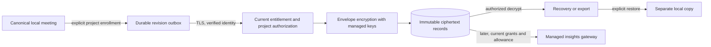

# ADR-003: Selected-project cloud archive before bidirectional sync

**Status:** Proposed architecture; no backend provisioned or upload implemented.  
**Date:** September 27, 2026. **Decision owner:** Trishan.  
**Contributes to:** [lunr-studio/Openbridge-Beta#316](https://github.com/lunr-studio/Openbridge-Beta/issues/316).  
**Next implementation:** [Dev #122](https://github.com/lunr-studio/Openbridge-Dev/issues/122), after [identity #118](https://github.com/lunr-studio/Openbridge-Dev/issues/118) and [entitlements #120](https://github.com/lunr-studio/Openbridge-Dev/issues/120).  
**Product contract:** V4 PRD (historical scope), especially sections 6.3, 9 and 10.  
**Priority/ownership:** [Project17](https://github.com/orgs/lunr-studio/projects/17); exact item state remains unverified because the current credentials lack Project read access. No board fields changed.

## Recommendation

Build a staging-only, selected-project archive first. The Mac remains canonical; it sends
immutable transcript revisions and can explicitly restore an archive into a separate local
copy. Remote meeting insights can later read the most recent authorized archived revisions
with honest freshness/coverage. Do not call this automatic multi-device sync.

| Option | Useful first proof | Cost / limitation |
|---|---|---|
| Encrypted archive + explicit restore | Authorization, encryption, idempotency, recovery, deletion | Other devices cannot silently edit the same project |
| Full bidirectional sync | Automatic convergence after offline edits | Requires inbox/outbox, conflict UX, replica checkpoints and migration proof together |
| No hosted copy | Existing free local library | Cannot support remote insights from an offline Mac |

Choose the archive as a prerequisite to V4 sync, not a replacement for the PRD's eventual
multi-client conflict requirements. Account creation alone never enrolls a project. Active
complimentary or paid access authorizes service use; separate project enrollment authorizes
upload. Source audio, voiceprints, API keys and unrelated/local-only meetings are excluded.



## Trust, encryption and access

This proposal is **service-managed encryption**, not end-to-end encryption: the authorized
service can decrypt selected records for export and future hosted AI. Make this visible
before enrollment. A client-only key design would need a different remote-insights/recovery
contract and is deferred rather than implied by the word “encrypted.”

- TLS protects upload. Encrypt each immutable revision using a vetted authenticated-encryption
  library and a fresh data key/nonce; wrap the data key under a project-scoped managed KMS key.
  Bind schema, account, project, meeting and revision IDs as authenticated associated data.
- Store ciphertext, wrapped key, key version and minimal routing metadata separately from
  authorization state. Never store plaintext transcript bodies in logs, analytics, crash reports
  or object names. Prefer random opaque IDs over titles or content hashes in public paths.
- The API derives account identity from a verified token, never the request's account ID.
  Every operation checks current ownership, enrollment, entitlement and deletion state.
  OAuth scopes/project grants additionally restrict future MCP calls; a bearer token alone
  cannot broaden access. Export after expiry uses a distinct recovery authorization path.
- Storage is private to the service identity. No public bucket, durable signed download URL
  or client-selected object path. Reads/downloads recheck authorization; bounded exports use
  authenticated expiry and the PRD's maximum seven-day export-package retention.
- KMS rotation rewraps data keys with recorded versions; it does not silently destroy old
  decrypt capability. Retain old keys only as needed for authorized records and allowed backups.
  Restore tests must pass before retiring versions. Key destruction cannot substitute for
  object deletion receipts or tenant authorization.
- Privileged operators and a compromised service remain threats under this design. Minimize
  decrypt roles, separate deployment/admin duties, audit content-free decrypt events and
  alert on unusual bulk access. This design does not claim protection against a fully
  compromised authorized server or against malware reading the user's local Mac library.

## Record and queue contract

The following is a **logical plaintext fixture**, before encryption. It is not a stored
object or network protocol implementation. IDs and meeting text are invented.

```json
{
  "schemaVersion": 1,
  "recordType": "meeting_transcript_revision",
  "accountID": "account_demo",
  "projectID": "project_docs",
  "meetingID": "meeting_demo",
  "revisionID": "revision_02",
  "parentRevisionID": "revision_01",
  "operationID": "operation_demo_02",
  "enrollmentGeneration": 1,
  "createdAt": "2026-09-27T12:00:00Z",
  "segments": [
    {"id": "segment_01", "startSeconds": 0, "endSeconds": 12,
     "text": "We will compare documentation hosting options.", "sourceLabel": "Room"}
  ],
  "provenance": {"origin": "original_transcript", "appBuild": "31", "sourceRevisionID": "original_01"},
  "deletedAt": null
}
```

The server maintains a schema-validated manifest and a conditional head pointer in a
transactional metadata store. Object storage holds encrypted immutable bodies. Select the
hosting region and database only after residency, backup/deletion support and cost review;
Firebase identity does not force meeting content into Firebase documents.

1. Opt-in captures explicit selected project IDs and creates an enrollment generation.
   Snapshot existing eligible local records; do not widen enrollment when a new project appears.
2. Persist an outbox entry before upload, referencing an immutable local revision. Recheck
   consent, retention/deletion and membership immediately before dispatch. Signing out pauses
   work and clears credentials. Bounded backoff retries transport failures, not denial.
3. An operation ID is unique within account/project/enrollment. Store its payload digest and
   result transactionally. Same ID + same payload returns the original result; changed
   payload returns a typed conflict. Retrying after a lost response never creates duplicates.
4. Head updates require the expected parent revision. A stale parent returns a conflict
   preserving both revisions. No timestamp-based last-writer-wins and no silent overwrite.
5. Commit metadata only after ciphertext durability; reconcile orphan blobs and pending
   metadata after failures. Hash checks validate transport/integrity, not permission.
6. Restore verifies envelope/schema/provenance and imports a separately named local copy.
   It never overwrites an existing local canonical meeting. Later bidirectional edits need
   their own conflict-resolution journey and explicit replay tests before promotion.

## Deletion, expiry, recovery and rollback

Follow PRD section 10 without extending its deadlines: server-known revocation stops new
hosted operations immediately, local features remain available, recovery/export lasts 30
days, active cloud deletion completes within 30 days, and encrypted backups roll off within
35 days. Keep cloud tombstones for 30 days after deletion completion and until active replicas
have observed them. Retire stale replicas/enrollment generations before purging tombstones;
a months-offline Mac must re-enroll/reconcile, not recreate deleted content from its old queue.

Pause/unsync stops future transfers and hosted insight eligibility; it does not mean deletion.
“Delete cloud copy” requires the user to confirm its project scope and receives a durable
receipt. Local deletion of a record in an enrolled project queues its cloud tombstone;
explain that coupling in enrollment and deletion UI. Cloud-only deletion preserves local data
but blocks old queued revisions from re-upload until deliberate new enrollment.

Migration is additive: a new outbox/checkpoint store never rewrites V3 transcripts. Feature
flag off + queue pause rolls back the client without deleting local records. Export cloud
data before retiring an incompatible service schema. A service rollback must keep the
deletion ledger authoritative and reapply it to any backup before serving restored data.
Never restore old grants, entitlement state or deleted objects merely by restoring a backup.

## Threat and acceptance matrix for the implementation issue

| Risk | Required staging proof before hosted beta |
|---|---|
| Cross-account/project access | Two accounts; forged IDs, paths and tokens denied on list, read, write, export and insights |
| Expired/revoked grant or unsynced project | Stale tokens and direct API/MCP calls fail; recovery route remains narrowly bounded |
| Replay / lost acknowledgement | Concurrent duplicate retries return one revision; changed payload conflicts |
| Offline conflict | Two devices retain both branches; no lost local text; deterministic conflict state |
| Corrupt ciphertext / swapped tenant metadata | Authentication or associated-data verification fails before parsing |
| Privacy leak | Synthetic canaries absent from logs, metrics and errors; network excludes audio/voiceprints |
| Deleted-content resurrection | Months-offline client and restored backup cannot resurrect tombstoned data |
| Key rotation or loss | Old/new envelopes recover under approved keys; missing/revoked keys fail closed |
| Rollback / partial outage | Original local library opens offline; paused outbox resumes idempotently |
| Deletion/export lifecycle | Exact active/backup/export deadlines and receipt verified against real staging resources |

## Bounded cost estimate and outstanding decisions

Sizing assumptions, not observed usage: 100 accounts × 20 meetings/month × 0.5 MB per
transcript/artifact snapshot × two revisions = approximately **2 GB of new records/month**.
After twelve months without deletions: 24 GB active, or 48 GB allowing an illustrative 2×
backup/version overhead. Audio is excluded. Measure large meetings/artifact growth before
setting actual per-account byte and revision limits.

For planning only, a storage coefficient of $0.02–$0.04/GB-month implies $0.96–$1.92/month
for that 48 GB. These are sensitivity assumptions, **not a verified regional storage quote**.
Google's [current KMS pricing example](https://cloud.google.com/kms/pricing) gives software
key versions at $0.06/month and symmetric operations at $0.03/10,000. At two projects per
account and two active key versions per project, 400 versions cost $24/month; 100,000
operations add $0.30. That yields an illustrative **$25.26–$26.22/month storage-plus-KMS
subtotal**, excluding database, requests, egress, compute, monitoring, tax, AI and search.
It is not an all-in service budget or spending authorization. Verify region-specific
[storage pricing](https://cloud.google.com/storage/pricing) and actual limits before deployment.

Outstanding owner/security decisions: hosting region and residency; transactional database;
per-project key hierarchy/rotation period; maximum record, account and project quotas;
backup purge/restore support; encryption disclosure; conflict UI; service spending cap.

Next order: accept this bounded archive direction → verified identity and complimentary/paid
entitlement foundations → staging authenticated metadata/object API and encryption → durable
client outbox → restore, deletion, export and adversarial two-account proof → bidirectional
sync. Do not start production uploads, hosted insights or a client queue before the server
authorization foundations exist. No new implementation issue duplicates Dev #122–124.
